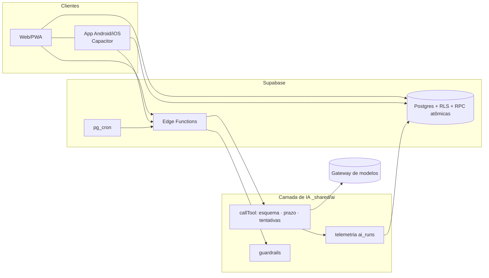
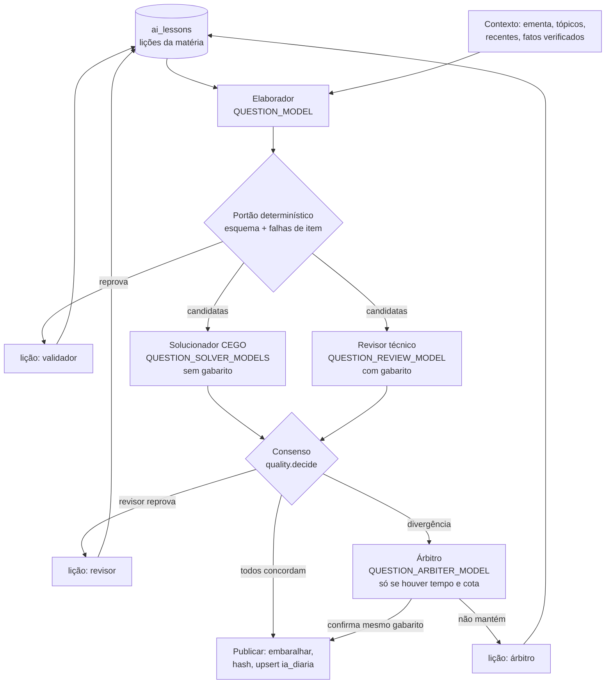

# Arquitetura multiagente do LevelUp Exams

**Análise de referências, diagnóstico, arquitetura-alvo e roadmap** · 16/11/2026
Escopo: AgroDecision (`jleonardopl1/agrodecision-d2525243`), TradingAgents (`TauricResearch/TradingAgents`),
o tópico `multi-agent-systems` do GitHub e referências mundiais de agentes de IA, apps Android/iPhone e SaaS.

---

## Sumário executivo

**Onde o LevelUp está.** A base é mais sólida que a média de SaaS educacional: gabarito nunca vai
ao cliente, RLS em todas as tabelas, RPCs atômicas para pontos e cotas, rate limit por usuário,
auditoria, webhook do Stripe idempotente e uma geração diária de questões com dois passes
(autor + revisor). O que faltava era **estrutura**: nenhum teste no front, nenhuma CI, lint
quebrado (9 erros), lockfile `npm` dessincronizado, chamadas de IA duplicadas e sem novas
tentativas, sem telemetria de custo/latência, e uma verificação de questões frágil — o revisor via
o gabarito (viés de ancoragem) e, por padrão, era o mesmo modelo do autor (erros correlacionados).

**O que as referências ensinam.**
1. *AgroDecision* (mesmo dono) já resolve a **governança** de agentes de desenvolvimento
   (AGENTS-COLLAB, 14 agentes por faixa, `rules/`, CI) e o princípio de **custo amortizado**
   ("1 sinal por commodity/hora, nunca por usuário").
2. *TradingAgents* mostra o **runtime** multiagente maduro: especialistas em paralelo com
   históricos isolados, **debate com rodadas limitadas**, gerente com modelo mais forte, saída
   estruturada com fallback, **memória com reflexão** e muitos testes de integridade.
3. O ecossistema (`multi-agent-systems`, 7.311 repositórios) tem no topo um tutor —
   **DeepTutor** (~60 mil estrelas) — com memória **auditável em camadas** e "portões de domínio".
4. A literatura converge: multiagente custa ~15× os tokens de um chat (Anthropic), e a maioria das
   falhas vem de **desenho** — papéis ambíguos e verificação fraca — não do modelo (MAST, NeurIPS 2025).
   Logo: multiagente **só onde verificação independente compra qualidade**, com limites explícitos.

**O que já foi implementado neste PR.**

| Entrega | Onde |
| --- | --- |
| Governança AGENTS-COLLAB com **17 agentes** de faixas exclusivas, `rules/`, bootstrap, handoff | `CLAUDE.md`, `AGENTS.md`, `AGENTS-COLLAB.md`, `.claude/`, `rules/`, `docs/colaboracao/` |
| **CI** (typecheck, lint, build, testes Deno, `deno check` das 11 funções) e templates | `.github/` |
| **Camada de IA compartilhada**: saída estruturada validada, prazo global, novas tentativas com backoff, telemetria só de metadados, cercas anti-injeção | `supabase/functions/_shared/ai/` |
| **Fábrica de questões multiagente**: Elaborador → portão determinístico → Solucionador **cego** ∥ Revisor → consenso → Árbitro só nas divergências → **memória de lições** | `supabase/functions/generate-track-questions/` |
| Discursiva e Mentor na camada nova (texto do aluno cercado; modelo configurável; telemetria) | `essay-review/`, `ai-mentor/` |
| Migration de telemetria (`ai_runs`), memória (`ai_lessons`), RPC atômica e retenção de 90 dias | `supabase/migrations/20261116120000_ai_runtime_observability.sql` |
| **−31% de JavaScript inicial** (328 → 226 kB gzip): gráficos deixaram de ser pré-carregados em toda página | `vite.config.ts` |
| Lint verde (9 erros corrigidos), `package-lock.json` sincronizado | `src/`, raiz |

Verificação: typecheck ✅ · lint ✅ (0 erros) · build ✅ · **30 testes Deno** ✅ · `deno check` 11/11 ✅ ·
migration executada 2× em Postgres em memória ✅ · smoke test do build no Chromium ✅.

**Próximos passos de maior impacto** (§10): aplicar a migration e publicar as funções (P0);
conformidade com o **ECA Digital** para alunos menores (P0); auditar as questões de IA já
publicadas com o Solucionador cego (P1); revisão espaçada **FSRS** e nota estimada por **TRI** (P2);
app nas lojas via **Capacitor** (P2).

---

## 1. Método

1. Leitura integral do código de IA do LevelUp (`ai-mentor`, `essay-review`,
   `generate-track-questions`, `_shared/`), migrations relevantes, docs e histórico.
2. Clonagem e leitura do AgroDecision (governança, `chatbot`, `sinal-ia-worker`, `rules/`, CI) e
   do TradingAgents (grafo, lógica condicional, estado, memória, saída estruturada, testes).
3. Consulta à API do GitHub ao tópico `multi-agent-systems` (ordenado por estrelas, 16/11/2026) e
   leitura do DeepTutor.
4. Pesquisa de fontes primárias: guias da Anthropic/OpenAI/Google, artigos (NeurIPS/ICML/ACL),
   OWASP, OpenTelemetry, legislação brasileira (LGPD, ECA Digital), decisões do CADE, ciência da aprendizagem.
5. Medições locais: typecheck, lint, build, tamanho de bundle, testes Deno, migration em PGlite.

---

## 2. Diagnóstico do LevelUp

### 2.1 Pontos fortes (manter)

| Prática | Evidência |
| --- | --- |
| Gabarito nunca no cliente; validação por RPC | `validate_answer`; Mentor recusa explicar questão de simulado em andamento (`ai-mentor/index.ts`, `loadQuestionBlock`) |
| RLS e RPC `SECURITY DEFINER` endurecidas | `20261110120000_security_hardening.sql`, `_access_level`, `has_role` |
| Cotas e pontos atômicos no banco | `consume_ai_mentor_quota`, `begin_essay_submission`, `increment_user_points` |
| Rate limit por usuário (não falsificável) | `checkRateLimit(supabase, "user:<id>", …)` |
| Stripe: assinatura, idempotência, preço escolhido no servidor | `stripe-webhook`, `create-checkout` |
| Nota da discursiva calculada no servidor; só conta erro cujo trecho existe no texto | `essay-review/rubric.ts` (+ testes) |
| Geração de questões com revisor, dedupe por hash e fatos verificados para legislação local | `generate-track-questions` (versão anterior) |

### 2.2 Lacunas encontradas

| # | Área | Achado | Risco | Status |
| --- | --- | --- | --- | --- |
| 1 | Qualidade de conteúdo | Revisor **via o gabarito** e era o **mesmo modelo** do autor por padrão | gabarito errado publicado (erros correlacionados, ancoragem) | ✅ resolvido (§5.3) |
| 2 | Qualidade de conteúdo | Alternativas embaralhadas **depois** da explicação; explicação que cita "alternativa B" fica errada | explicação incoerente para o aluno | ✅ prevenido; auditar antigas (P1) |
| 3 | IA | `callModel` duplicado, **sem nova tentativa**, sem prazo global, modelos fixos no código | falhas transitórias viram erro ao aluno; função estoura 150 s | ✅ camada `_shared/ai` |
| 4 | IA | Sem telemetria de tokens/latência/custo por agente | custo invisível; impossível comparar prompts/modelos | ✅ `ai_runs` |
| 5 | Segurança de IA | Texto do aluno entre `<<<`/`>>>` sem neutralizar os próprios delimitadores | injeção de prompt na correção | ✅ `fenceUntrusted` |
| 6 | Engenharia | **Sem CI**, sem testes no front, lint com 9 erros, `package-lock.json` dessincronizado (`npm ci` falhava) | regressões chegam à produção | ✅ CI + lint + lock; testes do front (P1) |
| 7 | Desempenho | `recharts` pré-carregado em **toda** página (105 kB gzip) por causa do `manualChunks` | 1º carregamento lento no 4G | ✅ −31% JS inicial |
| 8 | Pedagogia | Revisão espaçada em caixas fixas (1/3/7/14/30 dias) | revisões demais ou de menos | P2 (FSRS) |
| 9 | Pedagogia | Sem estimativa de proficiência por TRI (o ENEM usa TRI 3PL) | "nota estimada" pouco confiável | P2 |
| 10 | Privacidade | Público inclui **menores**; ECA Digital em vigor desde 17/03/2026 | sanções de até 10% do faturamento (teto R$ 50 mi por infração) | P0 (decisão D6) |
| 11 | Mobile | Só PWA; sem presença nas lojas; push limitado no iOS | aquisição e retenção menores | P2 (Capacitor) |
| 12 | Operação | Sem rastreamento de erros (Sentry) nem alertas | incidente descoberto pelo aluno | P1 |

---

## 3. Lições dos repositórios de referência

### 3.1 AgroDecision — governança e custo amortizado

**Adotado no LevelUp:**
- **AGENTS-COLLAB** com três camadas de documentação (estado vivo / convenções / catálogo) e
  ordem de leitura fixa — resolve a "amnésia entre agentes".
- **Elenco por faixas** com "o que não faz" explícito e três revisores distintos (saúde do
  projeto, qualidade do diff, segurança).
- **`rules/`** comum + por stack, **hook `SessionStart`**, handoff *fail-closed*, CI e templates.
- **Defesa de prompt** em todo agente.
- **Custo amortizado:** o `sinal-ia-worker` roda "por commodity/hora, nunca por usuário". No
  LevelUp: explicações por questão e temas de discursiva por cargo devem ser gerados uma vez e
  reutilizados (§5.4).
- **Fallback determinístico** quando a IA não está disponível.

**Não copiar (achados para o próprio AgroDecision):**
- `sinal-ia-worker` aceita a chamada quando `WORKER_SECRET` **não está definido** (`if (secret && …)`)
  — falha aberta; e as comparações de segredo não são em tempo constante.
- `chatbot` responde com `Access-Control-Allow-Origin: *`.
- O prompt do bot pede "sugira venda PARCIAL", em tensão com a regra "nunca recomendação" — o
  próprio `AGENTS-COLLAB.md` deles já registra isso como P0.

### 3.2 TradingAgents — runtime multiagente maduro

Framework de "empresa de trading" com analistas, pesquisadores *bull*/*bear*, trader, time de
risco e gestor de portfólio sobre LangGraph (Xiao et al., arXiv:2412.20138).

| Padrão do TradingAgents | Evidência no código | Aplicação no LevelUp |
| --- | --- | --- |
| Especialistas **em paralelo** com histórico **privado** (só o relatório sai) | `graph/setup.py` (`_analyst_graph`) | Solucionador e Revisor rodam em paralelo e independentes |
| **Debate com rodadas limitadas** e mapa de rotas completo (nunca quebra) | `conditional_logic.py`, `DEBATE_PATH_MAP` | Divergência vai a um árbitro único, com teto por execução |
| Dois tiers de modelo: *quick* para analistas, *deep* para gerentes | `default_config.py` | Solucionador barato (flash); árbitro forte (pro) só nas disputas |
| Saída estruturada com fallback | `agents/structured.py` | `callTool` + `parse` + nova tentativa; decisão final em código |
| **Memória com reflexão**: decisão → resultado → lição curta reinjetada | `memory/log.py`, `memory/reflection.py` | `ai_lessons`: reprovações viram lições da matéria |
| Teto de rodadas de ferramenta (evita loop) | `max_tool_rounds` | `maxAttempts`, `maxArbitrations`, prazo global |
| Disciplina contra **vazamento do futuro** (testes de *lookahead*) | `tests/test_*_lookahead.py` | Análogo: o Solucionador **não vê o gabarito** |
| ~100 arquivos de teste (integridade de prompt, rotas, checkpoints) | `tests/` | Testes Deno do pipeline com LLM falso |

### 3.3 Ecossistema `multi-agent-systems` (GitHub, 16/11/2026)

7.311 repositórios no tópico. Os mais relevantes para o LevelUp:

| Repositório | ★ | O que aproveitar |
| --- | --- | --- |
| HKUDS/DeepTutor | 59,7 mil | Tutor multiagente: **memória L1/L2/L3 auditável** (traço → fatos curados → síntese), "Mastery Path" com portão de domínio, banco de questões com revisão e próxima data |
| google/adk-python | 22,2 mil | Kit oficial do Google para construir, **avaliar** e implantar agentes |
| camel-ai/camel · owl | 18,0 / 20,2 mil | Papéis por *role-playing*; "workforce" de agentes |
| kyegomez/swarms | 7,4 mil | Padrões de orquestração (sequencial, hierárquico, *mixture*) |
| langroid/langroid | 4,2 mil | Programação multiagente leve, orientada a tarefas |
| 0xNyk/council-of-high-intelligence | 4,9 mil | Deliberação multiperspectiva (conselhos, tríades, duplas) |

Fora do tópico, mas referência obrigatória: **MetaGPT** (SOPs por papel), **AutoGen** (conversas
entre agentes), **LangGraph** (grafos com estado — base do TradingAgents) e **CrewAI**.
Conclusão: **não é preciso adotar um framework** — a fábrica de questões é um grafo pequeno e
fixo; código explícito em Deno, testável e sem dependência pesada, é a escolha certa no
Supabase Edge. Frameworks valem a pena se/quando houver agentes de longa duração com muitas ferramentas.

---

## 4. Princípios de referência mundial

### 4.1 Quando (não) usar multiagente
- **Anthropic — sistema de pesquisa multiagente:** orquestrador + subagentes em paralelo superou o
  agente único em 90,2% na avaliação interna, mas multiagente gasta **~15× os tokens** de um chat;
  o uso de tokens explica ~80% da variação de desempenho. Cada subagente precisa de objetivo,
  formato de saída, ferramentas/fontes e limites claros.
- **Anthropic — "Building effective agents":** comece simples; cinco padrões de *workflow* —
  cadeia de prompts, roteamento, paralelização, orquestrador–trabalhadores, avaliador–otimizador
  — antes de agentes autônomos.
- **OpenAI — guia prático de agentes:** padrão gerente (agentes como ferramentas) vs. *handoffs*
  descentralizados; guardrails em camadas; humano no circuito para ações de alto risco.
- **Cemri et al., "Why Do Multi-Agent LLM Systems Fail?" (NeurIPS 2025):** taxonomia MAST com 14
  modos de falha em 3 categorias (especificação/desenho, desalinhamento entre agentes,
  verificação e término). As falhas vêm do **desenho do sistema**.
- **Du et al., debate multiagente (ICML 2024):** várias instâncias que propõem e debatem melhoram
  factualidade e raciocínio — ao custo de mais computação.

### 4.2 Padrões mapeados às funcionalidades

| Funcionalidade | Padrão adequado | Por quê |
| --- | --- | --- |
| Fábrica de questões | Paralelização (votação/verificação) + avaliador + árbitro | Erro de gabarito é caro; verificação independente compra qualidade |
| Discursiva | Avaliador duplo + reconciliação (modelo INEP) | Notas variam entre corretores; discrepância → 3º |
| Mentor | Agente único com ferramentas + roteamento leve | Conversa; latência importa; poucas ferramentas |
| Plano de estudo semanal | Cadeia de prompts em lote (fora do horário de pico) | Barato, previsível, amortizado |
| Curadoria de reportes | Roteamento + avaliador, humano aprova | Ação editorial exige humano |

### 4.3 Protocolos abertos
- **MCP** (ferramentas e contexto para agentes) e **A2A** (agente↔agente), ambos hoje na Linux
  Foundation; **AGENTS.md** é padrão aberto da Agentic AI Foundation — por isso o LevelUp tem
  `AGENTS.md` além do `CLAUDE.md`. Futuro (P3): um servidor MCP de conteúdo do LevelUp para
  parceiros B2B.

### 4.4 Segurança de aplicações com LLM (OWASP Top 10 for LLM Applications 2025)

| Risco | Controle no LevelUp |
| --- | --- |
| LLM01 Injeção de prompt | `fenceUntrusted` + `UNTRUSTED_RULE`; delimitadores neutralizados |
| LLM02 Divulgação de informação sensível | Telemetria só de metadados; contexto do aluno montado no servidor e limitado |
| LLM05 Tratamento inadequado da saída | Toda saída passa por `parse`/validadores antes de virar dado |
| LLM06 Agência excessiva | Modelos não escrevem no banco; o código decide e grava |
| LLM07 Vazamento do prompt de sistema | Prompt sem segredos; Mentor instruído a não revelar |
| LLM10 Consumo ilimitado | Cotas diárias/semanais atômicas, rate limit, prazo e teto de tentativas |

### 4.5 Observabilidade
As **convenções semânticas de GenAI do OpenTelemetry** padronizam operação, provedor, modelo e
tokens (`gen_ai.request.model`, `gen_ai.usage.input_tokens`…) e operações de agente
(`invoke_agent`, `invoke_workflow`). `ai_runs` registra exatamente esses campos (e a linha
`orquestrador` é o *invoke_workflow*), pronta para exportar a qualquer backend OTel.

### 4.6 Ciência da aprendizagem (o diferencial de produto)
- **Prática de recuperação** e **espaçamento** estão entre as técnicas de maior utilidade
  (Roediger & Karpicke, 2006; Dunlosky et al., 2013) — o núcleo do LevelUp (questões, simulados,
  revisão) está certo; falta otimizar o *quando*.
- **FSRS** (dificuldade, estabilidade, recuperabilidade) supera o SM-2 em previsão de memória no
  maior *benchmark* público (~10 mil coleções do Anki, ~350 milhões de revisões).
- **TRI 3PL** (dificuldade, discriminação, acerto casual) é o modelo do ENEM; com as respostas
  reais dá para calibrar itens e estimar a proficiência do aluno.
- **Tutoria por IA** precisa de avaliação pedagógica própria — modelos ajustados para "ajudar"
  entregam a resposta cedo demais (LearnLM, Google DeepMind, 2024).

---

## 5. Arquitetura-alvo

### 5.1 Visão geral



Princípios: **dados e regras no Postgres** (RLS + RPC atômicas); **Edge Functions finas** na
borda; **toda IA por uma camada única** que valida, limita, mede e protege.

### 5.2 Camada de IA compartilhada (implementada)

| Módulo | Responsabilidade |
| --- | --- |
| `llm.ts` | `createGatewayClient().callTool()`: ferramenta obrigatória, `parse` valida (nulo = tentativa inválida), novas tentativas só em 408/409/425/429/5xx/529, timeout ou saída inválida; backoff exponencial com *jitter* e `Retry-After`; **prazo global** (não começa tentativa que não cabe); metadados por chamada. `modelFromEnv`/`modelListFromEnv` para modelos por papel |
| `telemetry.ts` | Acumula metadados e grava em lote em `ai_runs` no fim; tolera tabela ausente |
| `guardrails.ts` | `fenceUntrusted(label, texto)` e `UNTRUSTED_RULE` |

### 5.3 Fábrica de questões multiagente (implementada)



**Papéis**

| Agente | Vê o gabarito? | Modelo padrão | Saída |
| --- | --- | --- | --- |
| Elaborador | — (escreve) | `google/gemini-2.5-pro` | questões + explicações (sem citar letras) |
| Solucionador cego | **Não** (nem a explicação) | `google/gemini-2.5-flash` (lista; aceite famílias diferentes) | escolha, ambiguidade, confiança, fundamento |
| Revisor técnico | Sim | = Elaborador (configure outro) | aprovada + motivo concreto |
| Árbitro | Sim + divergências | = Elaborador | manter, gabarito correto, única correta, motivo |

**Regras de decisão (código testado em `quality.ts`):** reprova se o revisor não aprovar; aceita se
todos os solucionadores marcarem o gabarito sem apontar ambiguidade; qualquer divergência,
ambiguidade ou omissão vai ao árbitro, que só mantém se confirmar **o mesmo** gabarito e uma única
correta. Sem solucionador disponível, cai no critério anterior (só revisor) e marca *degradado*
na telemetria. Revisor fora do ar → nada é publicado.

**Portão determinístico:** esquema, "todas/nenhuma das anteriores", gabarito copiado no enunciado e
**pista de tamanho** (`length-cue.ts`, régua única com o seed e a auditoria): correta mais longa que
passa a maior errada em > 20%, correta > 1,5× a média das erradas ou correta muito mais curta, e
**teto por matéria** — se nas 40 questões recentes a correta já é a mais longa em mais de 35%, nova
candidata com a correta mais longa é recusada antes do revisor. O revisor também reprova pista de
forma qualitativa (correta única com ressalva ou tecnicismo, errada caricata, falta de paralelismo).
Não embaralha quando a explicação cita letras; alternativas numéricas vão em ordem crescente (Selecon).

**Prazo:** o pg_cron espera 150 s; orçamento de 140 s (`QUESTION_RUN_BUDGET_MS`). Solucionador e
revisor em paralelo; árbitro só com ≥ 20 s restantes; disputa sem árbitro é reprovada.

**Memória (reflexão):** motivos de reprovação viram lições normalizadas e contadas por recorrência
(`record_ai_lessons`); as 8 mais recorrentes entram cercadas no prompt do Elaborador. A equipe
desativa uma lição com `is_active = false`.

**Custo:** em relação à versão anterior (2 chamadas "pro" por matéria), soma 1 chamada barata
("flash") e o árbitro só nas divergências (teto de 3 questões por matéria). Estimativa (a confirmar
em `ai_runs`): +10% a +40% de tokens — muito longe do "15×" de um sistema multiagente aberto, porque o
grafo é fixo e limitado.

**Interruptores (secrets):** `QUESTION_PIPELINE=classic` volta ao fluxo anterior;
`QUESTION_SOLVER_MODELS`, `QUESTION_ARBITER_MODEL`, `QUESTION_REVIEW_MODEL`,
`QUESTION_MAX_ARBITRATIONS`, `QUESTION_RUN_BUDGET_MS`.

**Como medir (consultas em `ai_runs`):** taxa de disputa = `disputed/generated`; taxa de
aprovação = `inserted/requested`; `acceptedDegraded > 0` indica solucionador fora do ar; latência
p95 por agente; tokens por questão publicada. Meta de produto: reportes "gabarito errado" por mil
respostas de questões `ia_diaria` ≤ os das autorais.

### 5.3.1 Radar de Concursos (implementado em 2026-11-17)

Orquestrador–trabalhadores **hierárquico**: gerente master em código (orçamento, fila,
consolidação, avisos) → um coordenador por área (`radar_areas`) → especialistas (Batedor,
Analista de edital, Verificador de outro modelo, Analista de banca, Arquiteto de trilha). Só o
trecho novo de cada fonte vai para a IA; cada fato precisa de evidência literal conferida em
código e de confirmação do verificador; o que é arriscado (retificação, fase que volta atrás,
verificador fora) vai para revisão humana. Rascunho de trilha só vira trilha com aprovação do
admin. Detalhes em `docs/RADAR_CONCURSOS.md`.

### 5.4 Mentor IA (próximo passo)
1. **Tutor socrático**: perguntar antes de entregar, adaptar ao nível; avaliação pedagógica com
   rubrica inspirada no LearnLM (não revelar cedo, corrigir equívoco, incentivar metacognição).
2. **Ferramentas** (agente único com ferramentas, não multiagente): `meu_progresso`,
   `fila_de_revisao`, `explicar_questao`, `agendar_revisao` — cada uma uma RPC já existente.
3. **Cache amortizado de explicações** por (questão, alternativa marcada): a primeira explicação
   é gerada e revisada uma vez e servida a todos; corta custo e latência do botão "Explicar".
4. Roteamento leve (dúvida conceitual × explicação × plano × motivação) para modelos/temperaturas diferentes.

### 5.5 Discursiva (decisão D7)
Modelo do INEP para a redação do ENEM: **dois corretores independentes**; se as notas diferirem em
mais de 100 pontos no total ou mais de 80 numa competência, vai a um **terceiro**. Aplicação:
dois "corretores" (modelos diferentes) em paralelo, reconciliação determinística (média se
próximos; terceiro só na discrepância), calibração periódica com corretores humanos. Dobra o custo
por correção — por isso é decisão do dono.

### 5.6 Motor adaptativo (P2)
- **FSRS** no lugar das caixas fixas: parâmetros otimizados com o histórico de respostas;
  data de revisão comprimida perto da prova (regra que já existe).
- **TRI 3PL**: calibrar itens com respostas reais (centenas de respostas por item) → nota estimada no
  Simulado Oficial e seleção adaptativa (CAT) nos simulados de treino.
- **Domínio por tópico do edital** (BKT/DKT simplificado) → "foco do dia" baseado em evidência.
- **Analista de desempenho** (agente em lote, semanal): plano de estudo até a prova, gerado fora
  do pico, com custo fixo por aluno ativo.

### 5.7 Agentes internos de operação
- **Auditor de questões** (lote): roda o Solucionador cego sobre as questões `ia_diaria` já
  publicadas; divergências vão para a fila de reportes do admin.
- **Triagem de reportes**: agrupa reportes por questão e sugere a correção; humano aprova.
- **Monitor de custo**: alerta quando tokens/dia ou erros por agente saem da faixa.

---

## 6. Android e iPhone

**Situação:** PWA instalável (manifest, service worker com cache do app, página `/instalar`).

**Recomendação:** **Capacitor** sobre o mesmo build Vite — reaproveita 100% do React e publica nas
duas lojas. React Native/Expo só se surgir requisito que o WebView não atenda (meça antes); uma
TWA (Trusted Web Activity) é atalho possível só para o Android.

**Diretriz 4.2 da App Store (funcionalidade mínima):** "site embrulhado" é recusado. Valor nativo
a entregar: push nativo (lembrete de revisão/sequência), **offline das trilhas e da fila de
revisão**, lembretes locais, compartilhamento nativo do resultado, biometria, haptics.

**Cobrança nas lojas (decisão D5):** compra digital dentro do app segue IAP/Google Play Billing,
salvo exceções. No Brasil, o CADE impôs medida preventiva contra as regras *anti-steering* da
Apple (2025) e aprovou acordo em 2026 que permite links para pagamento externo com comissão — com
regras específicas para apps infantis e portões parentais para menores. Confirme o texto vigente
com o jurídico antes de decidir. Arquitetura: um único registro de direitos (ex.: RevenueCat ou
tabela própria) convergindo Stripe + lojas em `profiles.tier`.

**Offline-first:** questões e trilhas em cache; respostas em fila local e validadas no servidor ao
reconectar (o gabarito nunca vai ao aparelho); conflito resolvido pelo servidor.

**Segurança mobile:** OWASP MASVS — tokens no Keychain/Keystore, *deep links* validados, sem
segredos no bundle, rótulos de privacidade das lojas coerentes com LGPD/ECA Digital.

---

## 7. SaaS de classe mundial

### 7.1 Segurança
Base forte (§2.1). Próximos controles: **Sentry** (front + funções, sem PII), varredura de
segredos e de dependências no GitHub (secret scanning, Dependabot), cabeçalhos de segurança no
host (CSP, HSTS), *Leaked Password Protection* no Supabase Auth, revisão do `security-reviewer`
obrigatória em auth/pagamentos/RLS/IA, teste de intrusão anual. Normas: OWASP ASVS (web), MASVS
(mobile), Top 10 para LLM.

### 7.2 Privacidade e menores (P0, decisão D6)
**ECA Digital** (Lei 15.211/2025), em vigor desde 17/03/2026 e fiscalizado pela ANPD, soma-se à
LGPD: verificação de idade confiável (fim da autodeclaração como mecanismo suficiente),
supervisão parental, proibição de perfilamento de menores para publicidade e de "caixas de
recompensa". Ações: inventário de dados de menores, fluxo de idade no cadastro, configurações
padrão protetivas, revisão da gamificação (recompensas são determinísticas — manter assim),
política de privacidade atualizada. Sanções: advertência, multa de até 10% do faturamento no
Brasil (teto de R$ 50 milhões por infração) e suspensão.

### 7.3 Confiabilidade
SLOs por jornada (login, responder questão, simulado, checkout) com orçamento de erro; padrões de
*Release It!*: timeouts e prazos (feito na IA), *circuit breaker* por provedor, *bulkheads*
(cotas), idempotência (feito no Stripe); *runbooks* para Stripe, geração de questões e gateway de IA.

### 7.4 Escala e desempenho
- Postgres: políticas com `(SELECT auth.uid())`, índices para consultas quentes (ranking, contexto
  do Mentor que lê até 3.000 tentativas por chamada → materializar "matérias fracas" por aluno),
  `pg_stat_statements` mensal.
- Filas: `pgmq` para trabalhos assíncronos (lote de auditoria, planos semanais) em vez de HTTP longo.
- Front: JS inicial já caiu 31%; próximos passos — orçamento de bundle na CI, imagens responsivas,
  Core Web Vitals reais (RUM).

### 7.5 FinOps de IA
`ai_runs` dá custo por agente/função/matéria. Regras: custo por aluno ativo como métrica de
negócio; gerar uma vez o que serve a todos; modelo barato onde a qualidade medida permitir;
cotas por plano coerentes com o custo.

### 7.6 Crescimento (P3)
Multi-tenant B2B (cursinhos e escolas, como as cooperativas no AgroDecision): tenant por
organização, RLS por tenant, marca própria, painel do professor; API/MCP de conteúdo para parceiros.

---

## 8. Avaliação contínua (evals)
1. **Golden sets**: questões com gabarito conhecido (autorais + erros reais já corrigidos),
   redações com nota humana, conversas de Mentor anotadas.
2. **Regressão de prompt/modelo**: toda `promptVersion` nova roda contra o golden set antes de ir
   para produção; comparação lado a lado de acerto, custo e latência.
3. **LLM como juiz** só calibrado contra rótulos humanos (concordância medida).
4. **Métricas de produto** ligadas à estrela-guia: simulados concluídos/semana, retenção D7/D30,
   reportes de gabarito errado por mil respostas, desvio da nota da discursiva vs. humano.

---

## 9. Governança multiagente de desenvolvimento (implementada)

- **17 agentes** em `.claude/agents/` (coordenador, gerente-contexto, arquiteto-dados, supabase-db,
  edge-functions, engenheiro-ia, curador-conteudo, cientista-aprendizagem, frontend, mobile,
  designer, pagamentos, tester, reviewer, code-reviewer, security-reviewer, documentation-writer).
  Novos em relação ao AgroDecision: `engenheiro-ia`, `curador-conteudo`, `cientista-aprendizagem`,
  `mobile` e `pagamentos` — as áreas que decidem se o LevelUp é o melhor do mundo.
- **Contrato de delegação** (objetivo, saída, fontes, limites) e verificação em três faixas.
- **Estado vivo** em `AGENTS-COLLAB.md`; **regras** em `rules/`; **bootstrap** por hook.
- **CI** como portão objetivo — nenhum agente "acha" que está pronto; a CI diz.

Uso: peça ao Claude Code "use o `coordenador` para planejar X"; para uma faixa específica, chame o
agente pelo nome. No Lovable e em outras ferramentas, o `AGENTS.md` aponta o caminho.

---

## 10. Roadmap

| Fase | Itens | Faixas | KPI |
| --- | --- | --- | --- |
| **P0 — esta semana** | Aplicar migration e publicar funções (§11); 7 dias observando `ai_runs`; plano de conformidade ECA Digital (D6) | supabase-db, engenheiro-ia, security-reviewer | 0 erro de geração; taxa de disputa medida |
| **P1 — 2 a 4 semanas** | Auditor em lote das questões `ia_diaria`; Vitest no front; painel de custo/latência e curadoria de lições; reportes resolvidos viram lições; Sentry + alertas | engenheiro-ia, tester, frontend, curador-conteudo | reportes de gabarito ↓; cobertura das regras críticas |
| **P2 — 1 a 3 meses** | FSRS; TRI 3PL e nota estimada; Mentor socrático com ferramentas + cache de explicações; discursiva dupla (D7); app nas lojas com Capacitor (D5) | cientista-aprendizagem, engenheiro-ia, mobile, pagamentos | simulados/semana ↑; retenção D30 ↑ |
| **P3 — 3 a 12 meses** | B2B multi-tenant; simulados adaptativos (CAT); trilhas de outras bancas (Cebraspe certo/errado, 5 alternativas); MCP de conteúdo | arquiteto-dados, curador-conteudo, frontend | receita B2B; nº de trilhas ativas |

---

## 11. Implantação deste PR

> **Status (16/11/2026):** implantado. PR mesclado (`9d10578`); migration aplicada e registrada
> como `20261116120000 / ai_runtime_observability`; as três funções publicadas pelo agente do
> Lovable. Produção é **Lovable Cloud** (`rxsovhyimflzvxggppal`): migrations e publicação de funções
> passam pelo agente do Lovable (no editor ou pelo MCP do Lovable) — o MCP do Supabase da conta do
> dono não alcança esse projeto, e as funções **não** são publicadas sozinhas a partir do GitHub.

1. **Migration:** pedir ao agente do Lovable que aplique `20261116120000_ai_runtime_observability.sql`
   exatamente como está. É idempotente; cria `ai_runs`, `ai_lessons`, `record_ai_lessons`,
   `purge_old_ai_runs` e o job `purge-ai-runs` (se houver pg_cron). A ferramenta do Lovable também
   grava uma cópia em `drizzle/` e regenera `types.ts` — é esperado.
2. **Funções:** pedir ao agente do Lovable que publique `generate-track-questions`, `essay-review` e
   `ai-mentor` com o código da `main`. A ordem com a migration não importa — sem as tabelas,
   telemetria e lições só avisam no log.
3. **Secrets opcionais:** `QUESTION_SOLVER_MODELS` (recomendado: um modelo de outra família
   disponível no gateway, separado por vírgula de um segundo, se quiser dois votos),
   `QUESTION_REVIEW_MODEL` diferente de `QUESTION_MODEL`, `QUESTION_ARBITER_MODEL`, `MENTOR_MODEL`.
4. **Verificar:** no painel admin → geração de questões (as execuções continuam aparecendo em
   `question_generation_runs`); no SQL Editor:
   ```sql
   select agent, status, count(*), round(avg(latency_ms)) ms, sum(input_tokens) tin, sum(output_tokens) tout
   from ai_runs where created_at > now() - interval '1 day' group by 1, 2 order by 1;
   select metadata from ai_runs where agent = 'orquestrador' order by created_at desc limit 20;
   ```
5. **Desfazer:** secret `QUESTION_PIPELINE=classic` desliga solucionador e árbitro sem redeploy;
   reverter o commit restaura o código anterior (as tabelas novas podem ficar).

---

## 12. Referências

**Repositórios analisados**
- AgroDecision — https://github.com/jleonardopl1/agrodecision-d2525243
- TradingAgents — https://github.com/TauricResearch/TradingAgents
- Tópico multi-agent-systems — https://github.com/topics/multi-agent-systems
- DeepTutor — https://github.com/HKUDS/DeepTutor · Google ADK — https://github.com/google/adk-python
- AGENTS-COLLAB.md — https://github.com/Rlealbarili/Agents-Collab.md · ECC — https://github.com/affaan-m/ECC

**Guias e artigos de engenharia**
- Anthropic, "Building effective agents" — https://www.anthropic.com/engineering/building-effective-agents
- Anthropic, "How we built our multi-agent research system" — https://www.anthropic.com/engineering/multi-agent-research-system
- OpenAI, "A practical guide to building agents" — https://cdn.openai.com/business-guides-and-resources/a-practical-guide-to-building-agents.pdf
- OWASP Top 10 for LLM Applications 2025 — https://genai.owasp.org/2024/11/17/owasp-reveals-2025-top-10-risks-for-llms-new-sponsorship-program/
- OpenTelemetry, convenções de GenAI — https://opentelemetry.io/docs/specs/semconv/gen-ai/
- A2A + MCP na Linux Foundation — https://www.linuxfoundation.org/press/a2a-protocol-surpasses-150-organizations-lands-in-major-cloud-platforms-and-sees-enterprise-production-use-in-first-year

**Artigos científicos**
- Xiao et al., *TradingAgents* — https://arxiv.org/abs/2412.20138
- Cemri et al., *Why Do Multi-Agent LLM Systems Fail?* (NeurIPS 2025) — https://arxiv.org/abs/2503.13657
- Du et al., *Improving Factuality and Reasoning through Multiagent Debate* (ICML 2024) — https://arxiv.org/abs/2305.14325
- Yao et al., *ReAct* — https://arxiv.org/abs/2210.03629 · Shinn et al., *Reflexion* — https://arxiv.org/abs/2303.11366
- Wang et al., *Self-Consistency* — https://arxiv.org/abs/2203.11171 · Zheng et al., *LLM-as-a-Judge* — https://arxiv.org/abs/2306.05685
- Hong et al., *MetaGPT* — https://arxiv.org/abs/2308.00352 · Wu et al., *AutoGen* — https://arxiv.org/abs/2308.08155
- Google DeepMind, *Towards Responsible Development of Generative AI for Education* (LearnLM) — https://arxiv.org/abs/2407.12687
- Roediger & Karpicke (2006), *Test-Enhanced Learning*, Psychological Science 17(3)
- Dunlosky et al. (2013), *Improving Students' Learning With Effective Learning Techniques*, PSPI 14(1)
- Benchmark de algoritmos de repetição espaçada (FSRS × SM-2) — https://expertium.github.io/Benchmark.html

**Brasil: educação, regulação e mercado**
- TRI no ENEM (modelo logístico de 3 parâmetros) — https://institutoayrtonsenna.org.br/app/uploads/2023/09/proced_calculo_notas.pdf
- Correção da redação do ENEM (discrepância e 3º corretor) — https://www.cnnbrasil.com.br/educacao/redacao-do-enem-perguntas-e-respostas-sobre-a-correcao/
- ECA Digital (Lei 15.211/2025) — https://www.machadomeyer.com.br/pt/inteligencia-juridica/publicacoes-ij/direito-digital/estatuto-digital-da-crianca-e-do-adolescente-lei-n-15-211-2025-entra-em-vigor-em-17-de-marco-de-2026
- CADE × Apple (pagamentos e *anti-steering*) — https://www.gov.br/cade/en/matters/news/cade-upholds-interim-measure-against-apple/AppleAppealCADEsDecisionEnligshversion.pdf/@@download/file

**Mobile**
- Capacitor × React Native para app web existente — https://www.pkgpulse.com/guides/react-native-vs-expo-vs-capacitor-cross-platform-mobile-2026
- App Store Review Guidelines (4.2 Minimum Functionality) — https://developer.apple.com/app-store/review/guidelines/

**Livros**
- Chip Huyen, *AI Engineering* (O'Reilly, 2025) — avaliação, RAG, agentes, custo.
- Martin Kleppmann, *Designing Data-Intensive Applications* — dados, consistência, filas.
- Michael Nygard, *Release It!* (2ª ed.) — timeouts, circuit breakers, bulkheads.
- Beyer et al., *Site Reliability Engineering* (Google) — SLOs e operação.
- Forsgren, Humble & Kim, *Accelerate* — métricas de entrega de software.
- Russell & Norvig, *Artificial Intelligence: A Modern Approach* (4ª ed.) e Wooldridge,
  *An Introduction to MultiAgent Systems* — fundamentos de agentes e sistemas multiagente.
- Brown, Roediger & McDaniel, *Make It Stick* — ciência da aprendizagem aplicada.
